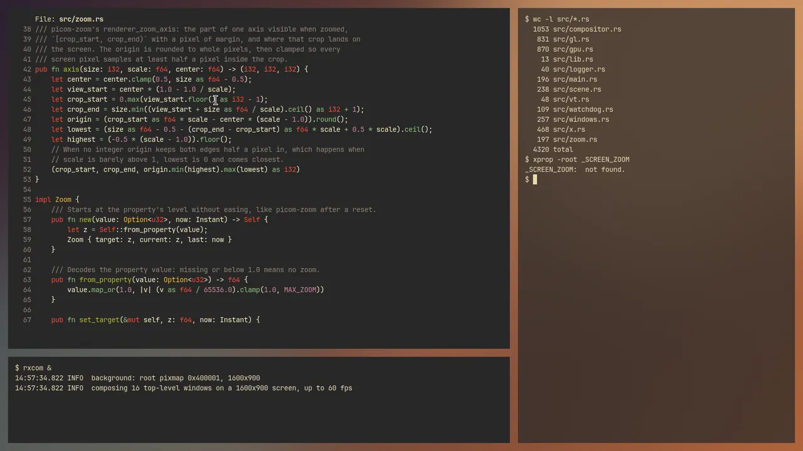
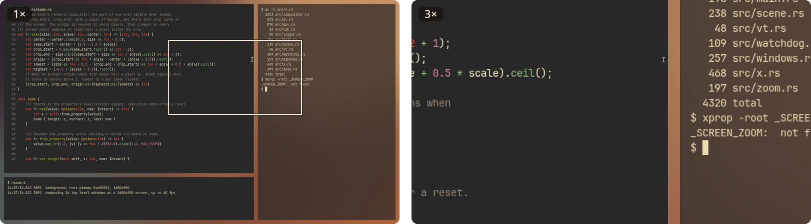
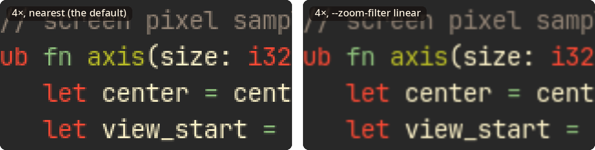

<p align="center">
  <picture>
    <source media="(prefers-color-scheme: dark)" srcset="docs/rxcom-header-dark.png">
    
  </picture>
</p>

<p align="center">
  An X11 compositor in Rust. The X server composes; the whole desktop zooms.
</p>

<p align="center">
  <a href="https://crazyboycjr.github.io/rxcom/">Homepage</a> ·
  <a href="#install">Install</a> ·
  <a href="#zoom">Zoom</a> ·
  <a href="#presenters">Presenters</a> ·
  <a href="DESIGN.md">Design</a> ·
  <a href="CHANGELOG.md">Changes</a>
</p>

<p></p>

## What it is

rxcom composites the windows of an X11 desktop, and magnifies all of it around
the pointer when you ask. It works the way xcompmgr does: the X server itself
composes the windows with XRender into one screen-sized picture, so no window's
contents ever leave the server. A presenter then puts that picture on the
screen, zoomed or not, and by default the presenter is the X server too.

- **Small.** rxcom is about 4,300 lines of Rust. With the default presenter it
  holds 4 to 5 MB of memory, and while nothing on the screen changes it draws
  nothing and uses no CPU.
- **Plain.** There are no shadows, fading, blur or rounded corners, and no
  configuration file, just a few options. Windows look the way their programs
  draw them, and translucent ones blend exactly.
- **Out of the way of games.** An opaque full-screen window, such as a game,
  gets the screen to itself after 200 ms, so it goes straight to the display,
  and rxcom takes over again as soon as anything else appears.
- **A zoom for the whole desktop.** As on macOS, everything on the screen
  magnifies from 1x to 16x around the pointer, and any window manager or script
  can drive the zoom through one root window property.

## Zoom

Set the zoom level on the root window and rxcom eases toward it in about a
quarter of a second, keeping the pixel under the pointer where it is. Clicks need
no translation, the cursor keeps its normal size, and as you move the pointer
the view follows it across the desktop.

<p></p>

The level lives in the root window property `_SCREEN_ZOOM`: CARDINAL, format
32, one value, the magnification in 16.16 fixed point. No property, or a value
of 65536 (1x) or less, means no zoom, and anything above 16x counts as 16x.
From a shell:

```sh
xprop -root -f _SCREEN_ZOOM 32c -set _SCREEN_ZOOM 131072   # 2x
xprop -root -remove _SCREEN_ZOOM                           # back to 1x
```

This script, `zoom-step`, zooms in or out by 1.2x each time it runs. Bind
`zoom-step in`, `zoom-step out` and `zoom-step off` to keys with sxhkd,
xbindkeys or your window manager:

```sh
#!/bin/sh
# zoom-step in|out|off: zoom the desktop in or out by 1.2x, within 1x to 16x.
z=$(xprop -root _SCREEN_ZOOM | sed -n 's/.* = //p')
case $1 in
in) z=$((${z:-65536} * 6 / 5)) ;;
out) z=$((${z:-65536} * 5 / 6)) ;;
*) z=0 ;;
esac
if [ "$z" -le 65536 ]; then
	xprop -root -remove _SCREEN_ZOOM
else
	xprop -root -f _SCREEN_ZOOM 32c -set _SCREEN_ZOOM $((z < 1048576 ? z : 1048576))
fi
```

xmonad can bind the same steps to keys directly:

```haskell
import XMonad
import XMonad.Util.EZConfig (additionalKeys)

-- | Multiply the desktop zoom by f, within 1x to 16x; rxcom eases toward it.
zoomBy :: Double -> X ()
zoomBy f = withDisplay $ \dpy -> do
    root <- asks theRoot
    atom <- getAtom "_SCREEN_ZOOM"
    prop <- io $ getWindowProperty32 dpy atom root
    let current = case prop of
            Just [v] -> fromIntegral v / 65536
            _ -> 1
        target = max 1 (min 16 (current * f))
    io $ changeProperty32 dpy root atom cARDINAL propModeReplace [round (target * 65536)]

main :: IO ()
main = xmonad $ def
    `additionalKeys`
        [ ((mod4Mask, xK_equal), zoomBy 1.2)       -- Super and =: in
        , ((mod4Mask, xK_minus), zoomBy (1 / 1.2)) -- Super and -: out
        , ((mod4Mask, xK_0), zoomBy 0)             -- Super and 0: off
        ]
```

A modifier and the wheel make a nicer zoom, but a plain grab of them lets the
window under the pointer scroll as well, since programs that scroll smoothly
see each notch before the grab does; [DESIGN.md](DESIGN.md#94-driving-it)
explains how a window manager avoids that.

Nearest filtering, the default, keeps every pixel square, so small text comes
out exactly as it was drawn, only bigger. `--zoom-filter linear` smooths it
instead.

<p></p>

## Presenters

`--present` picks what puts the composed desktop on the screen. Where GL or
Vulkan cannot start, the X server presents instead.

| Presenter | Status | How | Known issues |
| --- | --- | --- | --- |
| `x` | supported, the default | The X server copies the picture onto the screen, or draws it zoomed, with XRender. Works with any X server and driver. | It may tear, unless the driver keeps the screen tear-free itself, as NVIDIA's ForceFullCompositionPipeline does. |
| `gl` | experimental | GLX shows the picture as one texture, waits for the X server's drawing through X fences, redraws only what changed, and flips at vblank. | On NVIDIA it can stall the X server's switch to another VT. With systemd-logind 258 or newer and a rootless X started by startx, the keyboard and mouse may not come back ([systemd#43352](https://github.com/systemd/systemd/issues/43352)). |
| `vulkan` | experimental | The picture is a Vulkan image the X server draws into through DRI3, presented with FIFO_LATEST_READY and flipped at vblank. | On NVIDIA its flips turn on variable refresh (G-SYNC, FreeSync), which no setting turns off for one program, so it presents at every refresh, even when nothing changed, and keeps the GPU at its top clocks. |

## Install

**Arch Linux.** The package will be on the AUR as `rxcom`; until then, build it
from this repository:

```sh
git clone https://github.com/crazyboycjr/rxcom
cd rxcom/packaging/arch
makepkg -si
```

**From source.** You need Rust 1.88 or newer, libxcb, and `glslc` (from shaderc)
for the Vulkan presenter's shaders:

```sh
cargo build --release
install -Dm755 target/release/rxcom ~/.local/bin/rxcom
```

The X server needs Composite, DAMAGE, XFIXES, RENDER, SHAPE and SYNC, which
every Xorg has. The GL presenter loads libGL and libX11, and the Vulkan
presenter a Vulkan 1.3 driver, only when you choose them.

## Usage

Start it where your session starts, in `~/.xinitrc` or your window manager's
start-up:

```sh
rxcom &
```

rxcom refuses to start while another compositor runs, gives the screen back on
SIGINT or SIGTERM, and ignores SIGHUP, so it outlives the terminal it was
started from.

| Option | What it does |
| --- | --- |
| `--present x\|gl\|vulkan` | the presenter (default `x`) |
| `--unredirect-delay MS` | how long a full-screen window waits for the screen (default 200 ms) |
| `--no-unredirect` | always composite, games too |
| `--zoom-filter nearest\|linear` | how the zoom samples (default `nearest`) |
| `--max-fps N` | the frame limit (default: the refresh rate of the fastest lit monitor) |
| `--background RRGGBB` | the colour where no wallpaper is set (default `303030`) |
| `-v`, `-vv` | more logging; `-v` adds frame statistics every ten seconds |

`rxcom --help` lists the rest. A window can ask for the screen with
`_NET_WM_BYPASS_COMPOSITOR` set to 1, even with translucency, or ask to stay
composited with 2, as a lock screen might.

## How it was tested

Everything that draws ran on nested X servers, never on a desktop in use:

- `tools/nested-test.sh` starts an Xvfb with a wallpaper, a terminal and test
  windows of known pixels, runs rxcom, and compares screenshots with
  independent computations. The composited screen must equal the X server's
  own rendering, translucent windows must match premultiplied blending within
  one level, and the zoom from 2x to 16x must match the mapping computed in
  Python, pixel for pixel with nearest filtering. It also covers windows that
  move, resize, restack or draw late, full-screen windows, the screen saver, a
  stalled X server, and leaving the screen as it was found.
- `tools/stress-test.sh` runs openbox and throws hundreds of random moves,
  resizes, raises, iconifies, kills, zooms and wallpaper changes at rxcom, then
  compares the final screen with the X server's own rendering.
- `tools/xwayland.sh` provides a nested server with DRI3 (a headless mutter
  with a rootful Xwayland), where the Vulkan presenter runs the same suites
  under the validation layers.

```sh
cargo test --lib
cargo build --all-targets
tools/nested-test.sh                         # the X presenter, on Xvfb
RXCOM_TEST_PRESENT=gl tools/nested-test.sh   # GL, on Mesa's llvmpipe
tools/stress-test.sh 24 500
```

The suites need Xvfb, xdotool, xprop, xset, ImageMagick, feh, xterm, openbox
and Python with NumPy and Pillow; screenshots and logs go to
`$XDG_CACHE_HOME/rxcom-test`. [DESIGN.md](DESIGN.md#15-testing) has the
details, including the Xwayland runs.

Flips, pacing, variable refresh and VT switches only show on real hardware.
rxcom has run on NVIDIA's X driver at 3840x2160 and 240 Hz on an RTX 4070
SUPER, where the X presenter with ForceFullCompositionPipeline has been in
daily use; [DESIGN.md](DESIGN.md#13-costs) has what the three presenters cost
there.

## Design

[DESIGN.md](DESIGN.md) explains how rxcom works and why the X server composes:
what NVIDIA's X driver does with DRI3 exports, X Sync fences, GLX
texture-from-pixmap and variable refresh, how the zoom maps pixels, and what
each presenter costs.

## License

MIT; see [LICENSE](LICENSE). The screenshots show rxcom on a nested X server:
its own source code in Alacritty, over a generated wallpaper.
